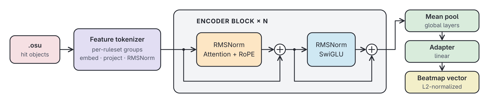

# BoBERT

**Bidirectional osu! Beatmap Encoder Representations from Transformers**

BoBERT learns dense representations of osu! beatmaps from their hit-object sequences across all four rulesets (`std`, `taiko`, `catch`, `mania`). Spatial patterns, rhythm, and object geometry are encoded into fixed-size embeddings. 
While recommendation and similarity search motivated the project, the pretrained embeddings can be adapted to a wider range of representation-learning tasks, including classification, clustering, and attribute prediction.

**[Try the search tool](https://bobert-web.pages.dev/)**

## Architecture

Each hit object is tokenized by per-ruleset feature groups ([FT-Transformer](https://arxiv.org/abs/2106.11959)) and fed through a pre-norm bidirectional Transformer ([ModernBERT](https://arxiv.org/abs/2412.13663)-style) with ±128 local attention and global attention every 3rd layer. Global-layer outputs are mean-pooled and passed through a learned linear adapter.



| | v16 | v16-mini (served) |
| --- | --- | --- |
| Parameters | 29.3M (std), 16M (taiko, mania), 7.2M (catch) | 4.7M |
| Layers / width | 9 / 512 (std), 384 (taiko, mania), 256 (catch) | 6 / 256 |
| Global attention | Layers 3, 6, 9 | Layers 3, 6 |
| Max sequence length | 4,096 hit objects | 4,096 hit objects |

| Ruleset | Pretraining maps | Indexed maps |
| --- | ---: | ---: |
| osu!standard | 692k | 746k |
| osu!taiko | 78k | 96k |
| osu!catch | 20k | 25k |
| osu!mania | 278k | 315k |

- **Pretraining**: Joint masked span reconstruction (30% masked), difficulty regression ([parsecore](https://github.com/Apart-Studio/parsecore) strains for `std`, SR for other modes), and self-contrastive alignment across interleaved 8-token halves.
- **Adaptation**: Contrastive linear adapter trained on co-occurring pairs from osu!collector and osu!stats collections (plus optional mined pairs).
- **Distillation**: `v16-mini` is structured-pruned from `v16` and distilled against its hidden states and top-256 PCA adapted vectors.
- **Retrieval**: 4-bit quantized vectors with CSLS hubness reduction (`sim(q, x) - 0.3 * mean_k500(x)`).

## Limitations

- Hit objects only (AR, CS, OD, HP are not inputs).
- Short maps produce noisier neighbors.
- Truncated at 4,096 hit objects.
- 1/3 and 1/4 rhythms separate in embedding space.
- Models and vector spaces are separate per ruleset.

## Local setup

Download a release from [Hugging Face](https://huggingface.co/token03/bobert):

```sh
uvx --from huggingface_hub hf download token03/bobert --revision v16 --local-dir runs/v16
mv runs/v16/data/* data/ && ln -sfn v16 runs/current
```

Copy [`.env.example`](.env.example) to `.env`, run `bun install` in `web/`, and start the stack:

```sh
mise run dev
```

## Training

Targets Linux x86-64, Python 3.12, PyTorch 2.11, CUDA 12.8:

```sh
uv sync --frozen
uv run pretrain my-run-base --mode std
uv run embed my-run-base --mode std
uv run adapt my-run-base my-run --mode std
uv run distill my-run my-run-mini --mode std
```

See [`scripts/README.md`](scripts/README.md) for data sync, evaluation, and release commands.

## Repository layout

| Directory | Contents |
| --- | --- |
| [`core/`](core/) | Parsing, features, encoder, dataset |
| [`training/`](training/) | Pretraining, adaptation, distillation |
| [`scripts/`](scripts/README.md) | Data pipeline, training CLIs, evaluation, releases |
| [`server/`](server/README.md) | FastAPI service, retrieval runtime, IRC bot |
| [`web/`](web/README.md) | React frontend and Cloudflare gateway |
| `data/`, `runs/`, `cache/` | Datasets, model artifacts, runtime cache |

## Acknowledgements

- [MusicBERT](https://arxiv.org/abs/2106.05630), [CM3P](https://github.com/OliBomby/CM3P), [ModernBERT](https://github.com/AnswerDotAI/ModernBERT), [FT-Transformer](https://github.com/yandex-research/rtdl-revisiting-models)
- [parsecore](https://github.com/Apart-Studio/parsecore) — star ratings and strain targets
- [osu!collector](https://osucollector.com/) and [osu!stats](https://osustats.ppy.sh/) — collection data
- [Beatconnect](https://beatconnect.io/) — `.osu` mirror
- [osu!](https://osu.ppy.sh/) and its mapping community

## License

[MIT](LICENSE)
